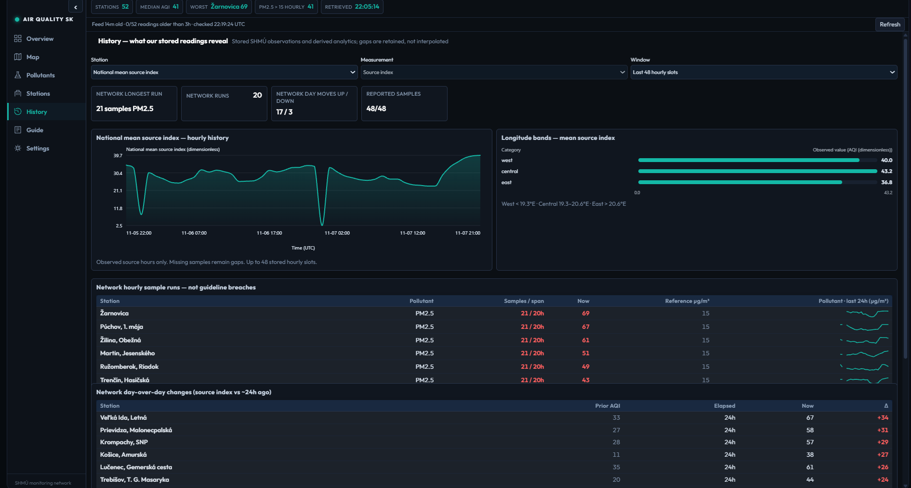
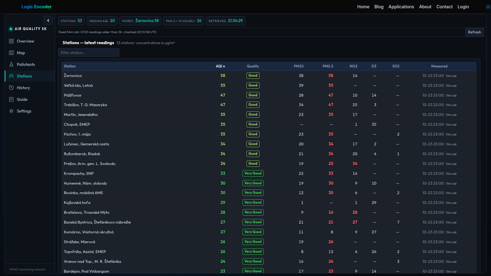

# Air Quality Slovakia

A single pollution reading means little without the station, the time and the surrounding history. The Air Quality Slovakia brings the hourly readings of every station in Slovakia's national monitoring network into one board and one map, so residents, parents, runners and anyone curious about the air can see where the air is clean, where it is not and how that changed over the last hours and days. It runs on [logicencoder.com](https://logicencoder.com) and updates every hour, matching the cadence of the published data.

## Tech stack

| Layer | Technologies |
|---|---|
| Data collection | Python worker that polls the public API of the Slovak national monitoring network (SHMU) once an hour |
| History | SQLite with one reading per station and hour, source revisions merged into the existing record |
| Delivery | REST ingest with an API key into a WordPress plugin written in PHP |
| Interface | Server-rendered table with delegated JavaScript for sorting, filtering and paging; AJAX refresh |
| Map | Leaflet with station markers and fullscreen mode |
| Charts | Lightweight in-house chart script (distribution, history and comparison charts) |
| Quality bands | Official SHMU air-quality classes from very good to very poor |

## Overview: the current picture

The Overview view opens with a live summary: how many stations reported in the latest snapshot and how many of them report a numeric quality index. Below it the station table lists every station with its latest observation time, its quality class as a coloured band and its pollutant readings in their own units. The table sorts worst-first by default, so stations with problem air appear at the top without any clicking.

Quick filters narrow the list to stations at a moderate quality level or worse, or at a poor level or worse, and a filter box finds a station by name. Paging at 25 stations per page keeps the network of more than fifty stations easy to scan. A distribution chart shows how many stations fall into each quality class, which answers the question "is it a bad day everywhere or only around a few stations" at a glance. A line with the national mean source index puts a single figure on the day; it is calculated from the stations that report an index, and the page says how many that is.

Stations that stop reporting leave the board after a few hours instead of showing stale numbers, so a station that is missing is a station that has no recent data.

## Map: air quality in its place

The Map view places every station on a Leaflet map and colours each marker by its quality class. Selecting a marker shows the station with its latest reading, and the fullscreen button gives the map the whole screen when comparing a region. Station location turns the question from "what is the number" into "what is around it": nearby stations that agree make a reading believable, and a single outlier is worth a second look before drawing conclusions.

## Stations

The Stations view is the searchable directory. Filter by name or quality class, and read each station's readings together with their observation times, in the same quality colours as everywhere else in the dashboard. Because every figure carries its time, a reading from this hour is never confused with one from the previous hour.

## Pollutants

The Pollutants view separates the measurements the network publishes: particulate matter PM10 and PM2.5, nitrogen dioxide, ozone and sulphur dioxide, all in micrograms per cubic metre. Choose a pollutant to compare stations on that one measurement and see how many stations report it. This answers a narrower question than "is the air good or bad": which pollutant drives the class at a station, and whether that pollutant is high only here or across the region.

## History and day comparison

History looks beyond the latest hour. Choose a period and a station or pollutant and the chart shows the hourly readings over that window; the Compare tools line up days against each other. Averages are coverage-checked: a daily mean is calculated only when all 24 hourly samples exist (eight-hour windows for ozone), and the page shows how many samples and what elapsed span stand behind a figure. A day with a gap is therefore labelled as partial, not silently averaged. Source corrections for the same station and hour replace the earlier reading in the record, so history follows the latest published values.

## Guide and settings

The Guide view explains the quality classes, the pollutants and the way averages are formed, so the numbers can be read correctly without leaving the page. In Settings, visitors choose the accent colour and density of the dashboard, which elements of the page chrome appear, and can reset all preferences.

## Where the data comes from

All figures come from the published readings of the Slovak national monitoring network (SHMU), shown with their observation times and units. The dashboard organises these observations for exploration and does not replace the official bulletins; for health decisions, follow the guidance of the authorities. An hourly reading describes one hour, and long-term exposure is a different question from a single hour's value.

---

Private code: [air-quality-slovakia-bridge](https://github.com/logicencoder/air-quality-slovakia-bridge)

See [REPOS.md](REPOS.md) for related repositories.

**[Logic Encoder](https://logicencoder.com)** · [GitHub](https://github.com/logicencoder) · [Contact](https://logicencoder.com/contact/)

<!-- TODO(screenshots, 2026-11-07): 2-3 interesting views instead of a single table -->
